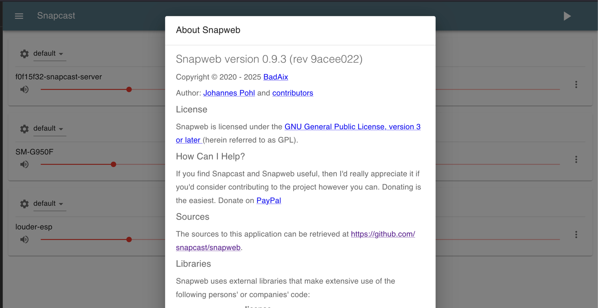
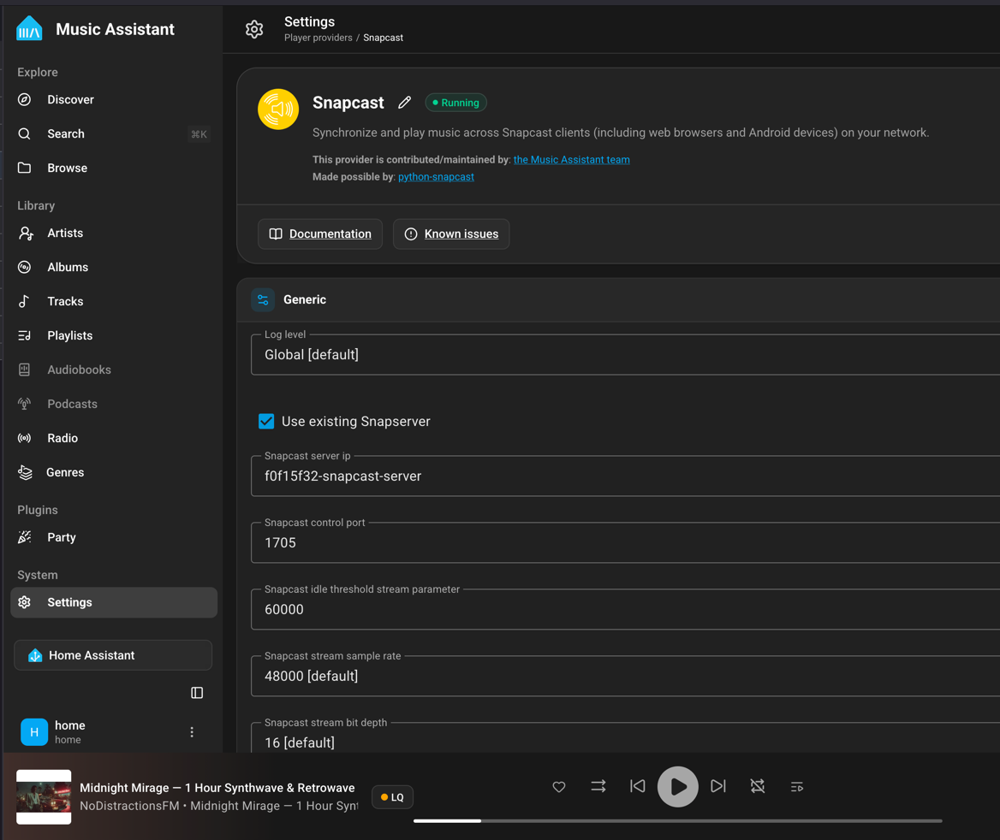
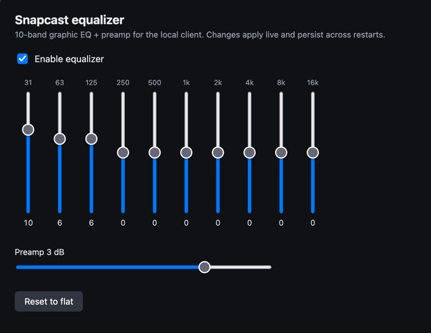

# Home Assistant Snapcast Server Add-on

This add-on provides a [Snapcast](https://github.com/snapcast/snapcast) server for Home Assistant OS.

It is designed to work with [Music Assistant](https://music-assistant.io/), which can create and manage audio streams through the Snapcast server. Snapcast clients can then connect to the server and play synchronized multi-room audio.

![Supports aarch64 Architecture][aarch64-shield]
![Supports amd64 Architecture][amd64-shield]

## About

This add-on runs the Snapcast server and provides:

* Snapcast server functionality for synchronized multi-room audio
* Integration with Music Assistant
* Snapcast Web interface
* mDNS service discovery
* ALSA and PulseAudio support for audio devices
* A permanent `default` silent stream available when the server starts
* Support for additional user-configured Snapcast streams

The `default` stream is always created automatically. It provides a silent PCM source so the Snapcast server always has an available stream, even when no additional streams are configured.

Additional audio sources can be configured using the `streams` option in the add-on configuration.

## Music Assistant

Music Assistant can use the Snapcast server to create and manage streams.

Playback and source management are handled by Music Assistant.

## Snapcast

Snapcast synchronizes audio playback between connected Snapcast clients, allowing multiple devices to play the same audio stream in sync.
A feature-packed Snapserver setup designed for seamless Home Assistant and Music Assistant integration.

* **Integrated Web Dashboard:** Includes the built-in [Snapweb](https://github.com/badaix/snapweb) web client directly accessible from your browser or Home Assistant Ingress/Sidebar.

    

* **Music Assistant Ready:** Fully compatible with Music Assistant dynamic audio streams (including default TCP stream auto-discovery).

    

* **mDNS / Avahi Auto-Discovery:** Instant client discovery across your local network (ESP32 `libsnapcast`, Android, Linux, Snapclient).

* Equalizer for pulse audio is included, allowing you to tune the local DAC output without affecting other clients.

    

For more information, see the [Snapcast documentation](https://github.com/snapcast/snapcast).

## License

This add-on is distributed under the MIT License.

[aarch64-shield]: https://img.shields.io/badge/aarch64-yes-green.svg
[amd64-shield]: https://img.shields.io/badge/amd64-yes-green.svg
